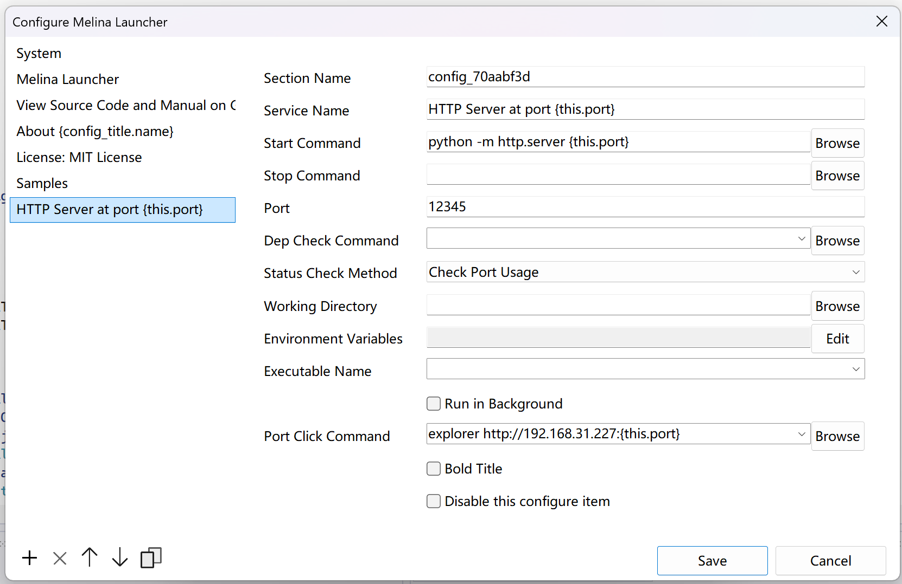

# Melina Launcher

Melina Launcher is a small Windows launcher for starting, stopping, and monitoring local programs.


## Screenshots




## Open the Settings Window

In normal use, you do not need to edit the `.toml` file by hand. The application has a built-in configuration window, and that window is the intended way to create and maintain launcher items. When you click Save, the app writes the configuration file beside the executable with the same base name and a `.toml` extension.

The code provides two ways to open the built-in settings window:

- Open the window system menu and choose `Settings...`.
- Start the application with `-c` or `--config`.

If no configuration file exists yet, the application creates a default one automatically before loading the main window.

## How the Settings Window Works

The settings window has two levels of configuration:

- `System` is the global configuration for the whole launcher.
- Every other item in the left list is one launcher entry.

From the code, the editor supports these actions directly in the UI:

- Add a new launcher entry.
- Delete an existing entry.
- Copy an entry.
- Move an entry up or down.
- Save changes.
- Preview the generated configuration text.

The main window reloads the configuration after the settings dialog closes, so saved changes take effect immediately in the launcher UI.

## System Settings

The `System` item controls launcher-wide behavior.

| Setting | Variable Name | Meaning in the app |
| --- | --- | --- |
| Title | `title` | The text shown in the main window title bar and header. |
| Refreash Interval (s) | `chk_interval` | Refresh interval for status checks, in seconds. The timer uses this value for automatic status refresh. |
| Hide Start All and Stop All | `hide_one_key` | Hides the batch `Start All` and `Stop All` buttons in the main window when enabled. |
| Variables | `var` | Shared variables for reuse across entries. Edited in a dedicated key/value editor dialog. |
| Language | `language` | UI language for the launcher and settings window. The code currently supports `en`, `zh-Hans`, `zh-Hant`, and `ja`. |

## Service Entry Settings

Each non-system item represents one service, tool, or local application in the launcher.

| Setting | Variable Name | Meaning in the app |
| --- | --- | --- |
| Section Name | N/A | Internal identifier for the entry. It is also the reference name used by cross-entry placeholders such as `{api.port}`. |
| Service Name | `name` | Display name shown in the launcher list. |
| Start Command | `command` | Start command. The launcher runs it through `cmd.exe /c`. |
| Stop Command | `stop_command` | Optional custom stop command. If empty, the launcher falls back to stopping the monitored process for supported status modes. |
| Port | `port` | Port number used by port-based status checking and port click actions. |
| Dep Check Command | `requirement_command` | Pre-start requirement check. This can be a real command or a built-in special value. |
| Status Check Method | `status_check_method` | How the launcher decides whether the entry is running. |
| Working Directory | `workdir` | Working directory used when running `command` and `port_click_command`. |
| Environment Variables | `environs` | Environment variables for the entry, edited as an ordered string array. |
| Executable Name | `executable_name` | Process name used for executable-based status checking and file-existence checks. |
| Run in Background | `run_background` | Starts the command with a hidden window when enabled. |
| Port Click Command | `port_click_command` | Command executed when the port value is clicked in the main window. |
| Bold Title | `display_bold` | Shows the entry name in bold in the main list. |
| Disable this configure item | `disabled` | Prevents the entry from appearing in the main launcher UI. |

## What the Main Window Does With These Settings

- Disabled entries are skipped entirely when the main window builds the service list.
- `title` becomes the main window title. If it is empty, the fallback title is `Melina Launcher`.
- `hide_one_key` controls whether the two batch buttons are visible.
- `chk_interval` becomes the refresh timer interval.
- `language` is applied before the window text is refreshed.
- Batch start and batch stop only act on visible, enabled entries.

## Variables and References in the UI

Even though the configuration is saved as text, the program supports references as a first-class feature in the editor. You enter these references in the relevant text fields inside the settings window, and the launcher resolves them when the configuration is loaded.

Placeholders use the form `{reference}`. The code expands them repeatedly until the value stops changing, up to 50 rounds.

### Shared Variables

Global variables are managed from `System -> var`. The editor opens a dedicated key/value grid, so users add variables by rows instead of writing a map manually.

- Keys are required.
- Keys must be unique.
- Lookup is case-insensitive.

To use a shared variable in another field, enter:

```text
{system.var,variable_name}
```

Example:

```text
workdir = {system.var,project_root}
command = dotnet run --project {system.var,project_root}\Api\Api.csproj
```

The loader also accepts `system.vars,key`, but the UI-generated configuration uses the `system.var,key` style.

### Cross-Entry References

Any entry can reference a setting from another entry by section name:

```text
{section_name.setting_name}
```

Example:

```text
{api.port}
{web.workdir}
```

This is how one launcher item can reuse another item's port, working directory, or display text.

### `this` References

Inside one entry, you can refer to another setting in the same entry with:

```text
{this.setting_name}
```

Example:

```text
command = dashboard.exe --listen {this.port}
port_click_command = explorer http://localhost:{this.port}
```

This is especially useful when the same port or path is used more than once in one entry.

### Label Double-Click to Copy a Reference

The settings form contains a small built-in helper: double-clicking a field label copies that field's reference text to the clipboard.

For example, double-clicking the `port` label in an entry with section name `api` copies:

```text
{api.port}
```

This works for both system settings and service entry settings, except `section_name`.

## Arrays and Key/Value Maps

The UI treats arrays and maps as dedicated editors instead of plain text fields.

### Arrays

`environs` is edited in a separate string-array window. The code supports:

- Add
- Remove
- Move up
- Move down
- Inline editing

Each item is stored as one string, typically in `NAME=value` form.

References can target the full array or one item by index:

```text
{entry.environs}
{entry.environs,0}
{entry.environs,1}
```

When the full array is referenced, the loader turns it into a semicolon-separated string.

### Maps

`System -> var` is the string-map editor. It is the only map-style setting exposed by the current code.

Each row has:

- `Key`
- `Value`

Those key/value pairs are what power `{system.var,key}` references throughout the launcher.

## Special Setting Values

Some settings have built-in behaviors beyond plain text.

### `status_check_method`

| Value | Meaning |
| --- | --- |
| `PORT_USAGE` | Treats the entry as running when something is listening on `port`. |
| `EXECUTABLE_EXISTANCE` | Treats the entry as running when the target executable process exists. The spelling is kept exactly as used by the code. |
| `NO_CHECK` | Disables running-state detection for the entry. |

Notes from the implementation:

- For `PORT_USAGE`, if `stop_command` is empty, the launcher stops the process by PID based on the port owner.
- For `EXECUTABLE_EXISTANCE`, `executable_name` can be an exact name or a regex-like value wrapped in `/.../`.
- If `executable_name` is empty, the launcher tries to infer the executable from the first token of `command`.

### `requirement_command`

| Value | Meaning |
| --- | --- |
| `CHECK_EXISTANCE` | Checks whether the executable file exists before start. The spelling is kept exactly as used by the code. |
| `DO_NOT_CHECK` | Skips prerequisite validation. |
| any other command | Runs the command and expects exit code `0`. |

When `CHECK_EXISTANCE` is used, the launcher checks `executable_name` first. If that is empty, it falls back to the executable inferred from `command`.

## Input Helpers in the Editor

The settings UI includes several editor-specific helpers:

- File-like fields such as `command`, `stop_command`, `requirement_command`, and `port_click_command` have a `Browse` button.
- `workdir` has a folder browser.
- Boolean settings appear as checkboxes when the current value is a valid boolean.
- `language`, `status_check_method`, and some other fields use dropdown lists.
- `port_click_command` offers ready-made browser-open commands for detected local IPv4 addresses, including a loopback default.

## Practical Notes

- `disabled` removes an entry from the visible launcher list rather than showing it in a disabled state.
- `port_click_command` defaults to opening `http://localhost:<port>/` when left empty.
- `environs` values are added to both `command` and `port_click_command`.
- The launcher saves configuration back to disk in its own supported TOML-like format, so using the settings window is the safest workflow.

----------------

Created by Melina in Nov 2020.
